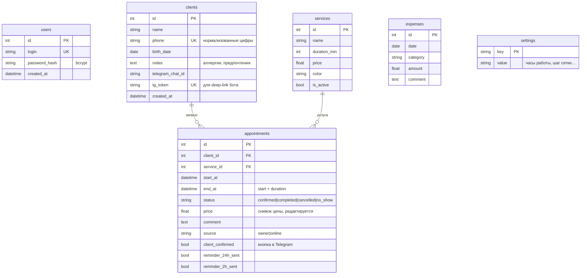

# 💅 Nail CRM — CRM для мастера маникюра

Веб-приложение для владельца маникюрного салона (один мастер): календарь записи, база клиентов,
финансы и аналитика, **публичная онлайн-запись** и **Telegram-напоминания** с кнопками
«Подтверждаю / Отменить». Адаптивный интерфейс — одинаково удобно с телефона и компьютера.

## Возможности

| Блок | Что умеет |
|---|---|
| **Календарь** | Сетка дня 9:00–21:00 с шагом 30 мин (настраивается), клик по свободному слоту → запись, автоматический расчёт окончания услуги, защита от накладок (на уровне API **и** constraint'ом в PostgreSQL), статусы «Подтверждена / Выполнена / Отменена / Неявка» с цветовой индикацией, линия текущего времени, загрузка дня в % |
| **Клиенты** | Карточка: имя, телефон, дата рождения, заметки (аллергии, предпочтения). История посещений, сумма трат, последний визит. Быстрый поиск по имени/телефону. Кнопка «Записать» из карточки |
| **Услуги** | Справочник: название, длительность, цена, цвет, активность (скрытие из онлайн-записи) |
| **Финансы** | Выручка = сумма выполненных записей за день/неделю/месяц, учёт расходов, чистая прибыль, средний чек, график выручки по дням, топ услуг |
| **Онлайн-запись `/book`** | Публичная страница без авторизации: клиент видит **только свободные окна**, записывается сам в любое время суток. Запись мгновенно появляется в календаре владельца (помечается 🌐) |
| **Telegram-бот** | Напоминания за 24 ч и за 2 ч с кнопками ✅/❌. Отмена клиентом **автоматически освобождает слот**. Владелец получает уведомления о новых онлайн-записях, отменах и подтверждениях |
| **Маркетинг** | Список клиентов, не приходивших 30/60/90+ дней, с готовым текстом приглашения и ссылкой на запись |
| **Эксплуатация** | Docker Compose, автоматический HTTPS (Caddy + Let's Encrypt), ежедневные бэкапы PostgreSQL локально + в S3 |

## Стек

- **Backend:** Python 3.12, FastAPI, SQLAlchemy 2 (ORM → защита от SQL-инъекций), Alembic (миграции), PyJWT + bcrypt
- **DB:** PostgreSQL 16 (в демо-режиме работает и на SQLite без установки чего-либо)
- **Frontend:** React 18 + Vite, собственный лёгкий day-grid календарь (без тяжёлых зависимостей), адаптивная вёрстка
- **Инфраструктура:** Docker Compose, Caddy (авто-HTTPS), контейнер бэкапов (pg_dump + aws-cli)
- Redis не требуется: один пользователь, JWT без серверных сессий — кэшировать нечего. Добавляется легко при росте.

---

## Структура базы данных (ER)



Миграции: `backend/alembic/versions/0001_initial.py`. В PostgreSQL дополнительно создаётся
**EXCLUDE-констрейнт**, который физически не даст двум активным записям пересечься по времени:

```sql
ALTER TABLE appointments
ADD CONSTRAINT appointments_no_overlap
EXCLUDE USING gist (tsrange(start_at, end_at) WITH &&)
WHERE (status IN ('confirmed', 'completed'));
```

> Все времена хранятся как «настенные» времена салона (переменная `TZ`). Один салон — один часовой
> пояс, никаких конвертаций и сюрпризов.

---

## API (кратко)

Интерактивная документация: `http://<хост>/docs` (Swagger).

| Метод и путь | Описание |
|---|---|
| `POST /api/auth/login` | Логин владельца → JWT |
| `POST /api/auth/change-password` | Смена пароля |
| `GET/POST /api/clients`, `GET/PATCH/DELETE /api/clients/{id}` | CRUD клиентов, `?q=` поиск, карточка со статистикой и историей |
| `GET/POST /api/services`, `PATCH/DELETE /api/services/{id}` | Справочник услуг |
| `GET /api/appointments?from&to` | Записи за период |
| `POST /api/appointments` | Создать (конец считается автоматически, пересечения → 409) |
| `PATCH /api/appointments/{id}` | Статус / перенос / цена / комментарий |
| `DELETE /api/appointments/{id}` | Удалить |
| `GET /api/slots?date&service_id` | Сетка слотов с флагом занятости |
| `GET/POST/DELETE /api/expenses` | Расходы |
| `GET /api/analytics/summary?from&to` | Выручка, средний чек, топ услуг, график по дням, прибыль |
| `GET /api/analytics/inactive?days=60` | «Пора обновить маникюр» |
| `GET/PUT /api/settings` | Часы работы, шаг сетки, рабочие дни, горизонт записи |
| `GET /api/public/config`, `/api/public/services`, `/api/public/slots` | Публичные данные для `/book` (без авторизации) |
| `POST /api/public/book` | Онлайн-запись (rate-limit 5 заявок/час с IP) |

---

## Быстрый старт (локальное демо, без Docker)

```bash
cd nail-crm/backend
python3 -m venv ../.venv && source ../.venv/bin/activate
pip install -r requirements.txt
alembic upgrade head                      # создаст SQLite-базу backend/data/dev.db
DEMO_SEED=1 uvicorn app.main:app --port 8000
```

Откройте `http://localhost:8000` — вход **admin / admin123** (демо-данные: клиенты, записи на
сегодня, история для аналитики). Публичная запись: `http://localhost:8000/book`.

Фронтенд уже собран в `backend/static`. Для разработки с hot-reload:

```bash
cd frontend && npm install && npm run dev   # http://localhost:5173, /api проксируется на :8000
npm run build && cp -r dist ../backend/static   # пересобрать прод-статику
```

Смоук-тест (29 проверок: авторизация, накладки, онлайн-запись, аналитика…):

```bash
python scripts/smoke_test.py http://127.0.0.1:8000
```

---

## 🚀 Развертывание на VPS (production)

### 1. Требования
- VPS: Ubuntu 22.04/24.04, 1 vCPU / 1 GB RAM / 10 GB диска (минимум), публичный IP
- Домен (или поддомен), например `crm.mysalon.ru`, с **A-записью на IP сервера**
- Открытые порты 80 и 443

### 2. Установка Docker
```bash
ssh root@YOUR_SERVER_IP
curl -fsSL https://get.docker.com | sh
```

### 3. Загрузка проекта
```bash
# с локальной машины:
scp -r nail-crm root@YOUR_SERVER_IP:/opt/nail-crm
# или git clone вашего репозитория в /opt/nail-crm
```

### 4. Настройка `.env`
```bash
cd /opt/nail-crm
cp .env.example .env
openssl rand -hex 16   # → POSTGRES_PASSWORD
openssl rand -hex 32   # → JWT_SECRET
nano .env              # заполнить DOMAIN, пароли, TZ, TELEGRAM_* (см. ниже)
```

### 5. Запуск
```bash
docker compose up -d --build
docker compose ps        # все сервисы healthy/running
docker compose logs -f backend
```

Готово:
- `https://crm.mysalon.ru` — кабинет мастера (Caddy **сам** выпустит и продлит SSL-сертификат)
- `https://crm.mysalon.ru/book` — ссылка онлайн-записи для клиентов (в шапку профиля соцсетей!)
- Вход: `OWNER_LOGIN` / `OWNER_PASSWORD` из `.env`. **Сразу смените пароль**: Настройки → Безопасность.

> Первый запуск без домена: оставьте `DOMAIN=:80` — сайт будет доступен по `http://IP` (без HTTPS).
> Как только домен заработает — впишите его в `.env` и `docker compose up -d`.

### 6. Обновление версии
```bash
cd /opt/nail-crm && git pull   # или scp новых файлов
docker compose up -d --build   # миграции применяются автоматически при старте
```

---

## 🤖 Telegram-бот: напоминания и отмены

1. В Telegram у **@BotFather**: `/newbot` → имя (например «Студия Ани | Напоминания») → получите **токен**.
2. Узнайте свой chat id у **@userinfobot** (просто напишите ему `/start`).
3. В `.env` на сервере:
   ```env
   TELEGRAM_BOT_TOKEN=123456:ABC-DEF...
   TELEGRAM_OWNER_CHAT_ID=123456789
   ```
   `docker compose up -d` — контейнер `bot` подхватит токен.
4. **Подключение клиента:** откройте карточку клиента → «Напоминания в Telegram» → «Копировать» →
   отправьте ссылку клиенту в любом мессенджере. Клиент нажимает «Старт» — готово, бот привязан.
   Ссылка имеет вид `https://t.me/YourBot?start=c_<секретный_токен>` (угадать чужой токен нельзя).
5. Дальше всё автоматически:
   - за **24 часа** и за **2 часа** бот шлёт напоминание с кнопками **✅ Подтверждаю / ❌ Отменить**;
   - «Отменить» → статус записи `cancelled`, **слот мгновенно освобождается** и снова виден в `/book`;
   - вам приходят уведомления: новая онлайн-запись, отмена, подтверждение.

Без токена бот просто простаивает — остальное приложение работает полностью.

---

## 💾 Резервное копирование

Контейнер `backup` раз в сутки (`BACKUP_INTERVAL_SECONDS`) делает `pg_dump | gzip`:
- локально в `./backups/` (хранение `BACKUP_KEEP_DAYS=14` дней, старые удаляются);
- опционально — в любое **S3-совместимое** хранилище (AWS, Selectel, Yandex Object Storage, VK Cloud, MinIO):
  заполните `S3_BUCKET`, `S3_ENDPOINT`, `AWS_ACCESS_KEY_ID`, `AWS_SECRET_ACCESS_KEY` в `.env`.

Ручной бэкап:
```bash
docker compose exec db pg_dump -U nailcrm nailcrm | gzip > backups/manual_$(date +%F).sql.gz
```

**Восстановление** (осторожно, заменяет текущую базу):
```bash
docker compose stop backend bot
docker compose exec -T db psql -U nailcrm -d postgres -c "DROP DATABASE IF EXISTS nailcrm WITH (FORCE);"
docker compose exec -T db psql -U nailcrm -d postgres -c "CREATE DATABASE nailcrm;"
gunzip -c backups/nailcrm_ГГГГММДД_ЧЧММСС.sql.gz | docker compose exec -T db psql -U nailcrm -d nailcrm
docker compose start backend bot
```

---

## 🔒 Безопасность

- Пароль владельца — **bcrypt**; JWT (HS256) с секретом из `.env`, срок 30 дней.
- **ORM** (SQLAlchemy) — параметризованные запросы, SQL-инъекции исключены.
- **HTTPS** автоматически (Caddy + Let's Encrypt), HTTP→HTTPS редирект из коробки.
- Публичные эндпоинты отделены (`/api/public/*`) и ограничены: 5 бронирований/час с IP,
  горизонт записи, минимальное время до визита, слот проверяется на сервере повторно.
- Накладки невозможны даже при гонке запросов — EXCLUDE-констрейнт в PostgreSQL.
- Токен deep-link бота случаен (uuid4), кнопки проверяют соответствие chat id клиента.
- `.env` и `backups/` исключены из git; секреты не попадают в образ.

---

## Структура проекта

```
nail-crm/
├── backend/
│   ├── app/
│   │   ├── main.py            # FastAPI + раздача SPA
│   │   ├── config.py          # настройки из env
│   │   ├── models.py          # ORM-модели
│   │   ├── schemas.py         # Pydantic-схемы
│   │   ├── security.py        # bcrypt + JWT
│   │   ├── slots.py           # расчёт свободных окон, защита от накладок
│   │   ├── seed.py            # владелец, услуги, демо-данные
│   │   ├── notify.py          # отправка в Telegram
│   │   ├── bot.py             # бот: long polling + планировщик напоминаний
│   │   └── routers/           # auth, clients, services, appointments,
│   │                          # finance, settings, public
│   ├── alembic/               # миграции (0001_initial + EXCLUDE constraint)
│   ├── requirements.txt
│   ├── entrypoint.sh          # alembic upgrade head → uvicorn
│   └── Dockerfile             # multi-stage: сборка React + Python
├── frontend/
│   └── src/
│       ├── pages/CalendarPage.jsx   # сетка дня + модалка записи
│       ├── pages/ClientsPage.jsx    # база клиентов + карточка
│       ├── pages/ServicesPage.jsx
│       ├── pages/AnalyticsPage.jsx  # KPI, график, расходы, «пора обновить»
│       ├── pages/SettingsPage.jsx
│       ├── pages/BookPage.jsx       # публичная онлайн-запись
│       └── ...
├── scripts/
│   ├── backup.sh / Dockerfile.backup
│   └── smoke_test.py          # e2e-тест API (29 проверок)
├── docker-compose.yml         # db + backend + bot + caddy + backup
├── Caddyfile                  # авто-HTTPS
└── .env.example
```

## Идеи для развития (после MVP)

SMS-шлюз как запасной канал напоминаний, лист ожидания на занятые слоты, абонементы,
склад материалов с автосписанием, экспорт в Excel, несколько мастеров (мультиарендность),
виджет записи для встраивания в сайт/соцсети.
